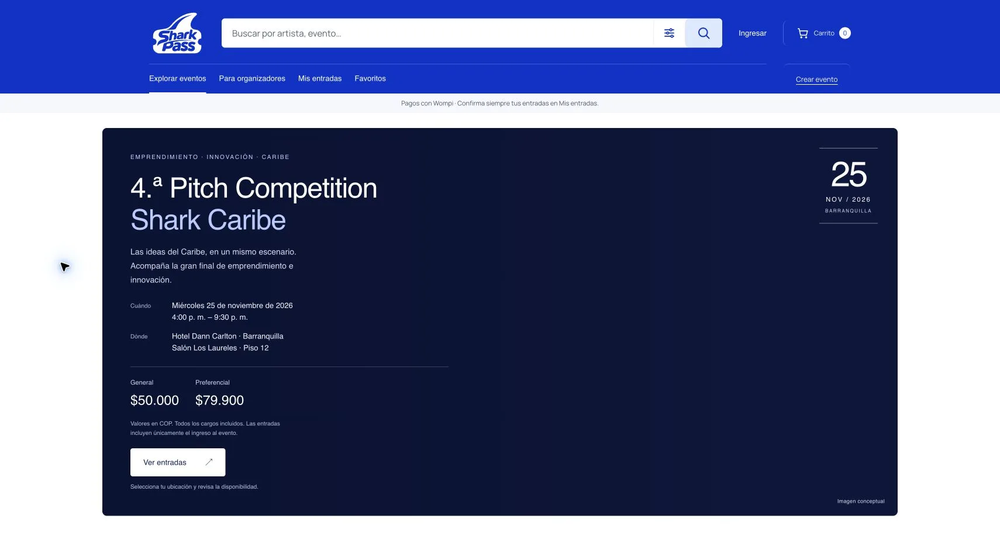

# SharkPass

Plataforma de venta de entradas y control de acceso para eventos. Incluye una web de compra, administración de organizadores y plataforma, entradas con QR único y un escáner instalable como PWA.

**Sitio público:** [sharkpass.co](https://sharkpass.co/).



## Para la convocatoria

Consulta la [guía de revisión](docs/REVISION_CONVOCATORIA.md), con el alcance de los hitos, el recorrido funcional y las limitaciones comprobadas. El repositorio permite revisar el código y ejecutarlo con una base vacía, sin credenciales comerciales. No incluye datos de compradores, sesiones, bases de datos ni secretos de producción.

## Aporte potencial al turismo

SharkPass facilita descubrir y comprar entradas para eventos que pueden motivar visitas al Caribe. Una agenda con mayor visibilidad y una compra más sencilla puede generar oportunidades para hoteles, restaurantes, transporte y comercios locales. Este potencial requiere alianzas y medición: no se presentan impactos turísticos o económicos como resultados ya demostrados.

## Estado al 8 de noviembre de 2026

La web está desplegada en Hostinger. Wompi está configurado en producción y el transporte SMTP está configurado. El evento oficial Shark Caribe está publicado con selección de silla: 50 puestos Preferencial y 50 General; los primeros 30 Preferencial están bloqueados por asignación del organizador. Las 50 cortesías están separadas del catálogo público. Los precios nuevos se desglosan con IVA del 19%: General $50.000 + $9.500 = $59.500 COP; Preferencial $79.900 + $15.181 = $95.081 COP. Las reservas y compras anteriores conservan sus importes originales.

**Pendiente operativo:** una compra real completa para comprobar la notificación de Wompi, entrega del correo y emisión del QR en producción; prueba física con tablets, prueba de carga y restauración desde un respaldo externo. La configuración activa de un servicio no equivale a certificar su operación completa.

La PWA de acceso trabaja con conexión. No se promete validación sin internet ni prevención de duplicados entre dispositivos desconectados. La app Expo es un cliente adicional en desarrollo; no está publicada en tiendas.

## Funcionalidades

- Registro e inicio de sesión por correo, verificación, recuperación y perfil.
- Catálogo, búsqueda, detalle del evento, carrito y checkout adaptable a móvil.
- Wompi con importe calculado en servidor, reserva temporal de 15 minutos, firmas verificadas, consulta de la transacción al proveedor e idempotencia.
- Sillas numeradas por localidad, bloqueo transaccional y registro nominal por asistente.
- Ticket individual con forma de tiburón y QR único; consulta, descarga, compartición y envío por correo. Compartir una entrada no multiplica sus usos.
- Organización de eventos, cupos y precios; permisos separados para propietario, escáner y administrador de plataforma.
- Panel administrativo con métricas, revisión de eventos, filtros, acciones protegidas y auditoría. El registro público no concede privilegios.
- PWA de control de acceso con cámara y búsqueda por código; validación de un único ingreso en el servidor.

## Arquitectura

| Parte | Tecnología | Ubicación |
| --- | --- | --- |
| Servidor/API | Node.js 22.17.1, HTTP y SQLite integrado | `src/` |
| Web pública y administración | HTML, CSS y JavaScript por módulos | `public/` |
| Control de ingreso PWA | Web App Manifest, service worker y cámara | `public/ingreso/` |
| Cliente móvil en desarrollo | Expo SDK 58, React Native y Expo Router | `apps/mobile/` |
| Esquema y evolución | Migraciones SQL con validación de checksum | `migrations/` |
| Validación | Pruebas Node y tipos móviles | `tests/` |

Se opera con **una instancia y una base SQLite compartida**. Las transacciones `BEGIN IMMEDIATE`, las restricciones y la idempotencia protegen el inventario en ese despliegue. No ejecutar réplicas con archivos SQLite independientes. La distribución en múltiples servidores requiere otra estrategia de base de datos y pruebas de carga.

SharkPass es independiente de Localia: no comparte sus cuentas, contraseñas ni tablas.

## Ejecutar localmente

Requisitos: Node **22.17.1**, npm y Git. Usar npm workspaces desde la raíz, con un único `package-lock.json`.

```sh
npm ci
npm run check
npm run build
npm run dev
```

Abre `http://localhost:3201`. El arranque de desarrollo crea una base independiente y persistente en el directorio de datos de SharkPass del usuario; se puede elegir otra ruta con `DATABASE_PATH`. Las variables reales no se incluyen. `.env.example` documenta sus nombres, pero `npm run dev` no carga ese archivo automáticamente.

Para cargar un archivo local creado a partir del ejemplo:

```sh
node --env-file=.env --experimental-sqlite scripts/dev.mjs
```

Deja vacías las credenciales para la revisión del código y las pruebas automáticas. Sin Wompi no se cobran entradas de pago; sin SMTP no se envían correos. No pongas secretos en variables `EXPO_PUBLIC_*`.

### Recorrido local sin pagos

1. Abre `/?demo=1` para la demostración visual identificada como ficticia. No crea compras ni reservas.
2. Para probar funciones reales en tu base local, registra una cuenta con datos sintéticos y entra en **Para organizadores**.
3. Crea una organización y un evento futuro identificado como DEMO; añade una localidad gratuita, cupo y publica.
4. Reserva una entrada desde el catálogo, revisa su QR en **Mis entradas** y valida su código desde el control de acceso con un usuario autorizado del evento. Un segundo intento debe rechazarse.
5. Las pruebas de `tests/seating.test.mjs` crean escenarios sintéticos de sillas y pagos para comprobar concurrencia, bloqueos y emisión. No se conectan a una cuenta comercial.

### Cliente Expo

```sh
npm run dev:mobile
npm run typecheck:mobile
npm run build:mobile
```

Consulta [el alcance móvil](apps/mobile/README.md). Una exportación de iOS/Android/web no es una app firmada ni publicada.

## Verificación

Última revisión: **94 pruebas aprobadas** con `npm run check`, exportaciones web/iOS/Android con `npm run build` y construcción/arranque del contenedor comprobados. Incluye autorización permitida y denegada, aislamiento de organizadores, compras concurrentes, QR de un uso, callbacks repetidos, reservas vencidas y migraciones que preservan compras existentes.

```sh
npm run check
npm run build
docker build -t sharkpass .
docker run --rm -p 127.0.0.1:3201:3000 -e PUBLIC_URL=http://localhost:3201 sharkpass
```

La base del contenedor sin volumen es temporal. Para persistencia, montar un volumen en `/data` con permisos del usuario `node`.

## Despliegue y secretos

Hostinger usa `src/hostinger.mjs`, comando de compilación `npm run build:server` y variables privadas de hPanel. Las cuatro credenciales Wompi son `WOMPI_PUBLIC_KEY`, `WOMPI_PRIVATE_KEY`, `WOMPI_INTEGRITY_SECRET` y `WOMPI_EVENTS_SECRET`. Producción requiere además `WOMPI_ENVIRONMENT=prod`, `WOMPI_ENABLE_PRODUCTION=yes` y `PUBLIC_URL` HTTPS. Las claves deben pertenecer al mismo ambiente.

El webhook de producción es `/api/payments/wompi/events/prod`. SMTP se configura mediante las variables del ejemplo. Nunca subir `.env`, bases, respaldos, tokens, QR de compradores ni tareas privadas de operación. Las migraciones aplicadas son inmutables.

Antes de migrar en el arranque administrado se genera un respaldo SQLite y se comprueba su integridad; una copia en el mismo servidor no sustituye el respaldo externo ni la prueba de restauración.

## Documentación

- [Guía para evaluadores](docs/REVISION_CONVOCATORIA.md).
- [Oferta de valor propuesta](docs/propuesta-de-valor.md).
- [Presentación de organizadores](docs/organizaciones-2026-11-07.md).
- [Lanzamiento oficial y validación](docs/lanzamiento-oficial-2026-11-07.md).
- [Escáner PWA](docs/ingreso-pwa.md).
- [Banner conceptual y prompt](docs/banner-sharkcaribe-2026-11-07.md).
- [Procedencia de imágenes](public/media/SOURCES.md).

Los documentos fechados describen revisiones históricas; este README y la guía de revisión indican el estado actual. La visibilidad pública del código no concede por sí sola una licencia de uso de la marca ni del material gráfico de terceros.
