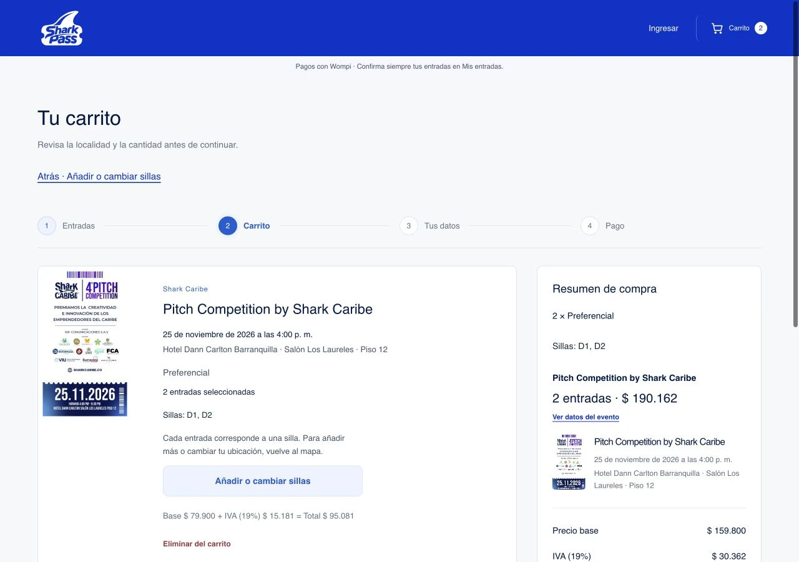

# Carrito y regreso al mapa

La prueba de usuarios encontró controles de cantidad desactivados en compras con sillas numeradas, pérdida de la selección al cambiar puestos y salida del sitio al usar Atrás del navegador.

Se muestra un botón visible «Atrás · Añadir o cambiar sillas» al comienzo del carrito y otro acceso junto a los puestos elegidos. Las compras numeradas muestran cantidad y sillas, sin controles +/− desactivados ni un selector de localidad inutilizable. El mapa conserva los puestos disponibles de la selección; permite añadir, quitar o cambiar de localidad y confirmar con «Actualizar carrito». Volver sin confirmar conserva el carrito anterior. Los puestos que dejaron de estar disponibles se avisan; no se sustituyen automáticamente. Se mantiene el límite de seis entradas por localidad y compra.

La navegación interna crea entradas de historial y Atrás/Adelante vuelve a representar la ruta sin añadir nuevas entradas. El ingreso durante la compra tiene regreso al carrito; al iniciar sesión, no deja un paso de autenticación intermedio innecesario. No se guardan nombres, correos ni contraseñas en el historial o el carrito.

Una reserva activa no se libera por visitar el mapa ni por usar Atrás. Antes de editar se consulta el pago y se utiliza la confirmación existente para liberar la reserva. Rechazarla conserva los puestos; aceptarla conserva los identificadores elegidos para editar. Los pagos confirmados o en revisión siguen sus restricciones anteriores. No se modifican las reglas del servidor, precios, IVA, cupos ni QR.

El flyer del carrito se muestra completo con object-fit: contain, sin estirarlo para cubrir toda la altura del artículo.

Validación: 102 pruebas aprobadas, incluyendo restauración de sillas, exclusión de puestos vendidos/reservados/de otra localidad, historial y rechazo de destinos externos. npm run check, npm run build y compilación/arranque de contenedor aprobados. Recorrido en navegador integrado a 390 px: una silla → carrito → mapa con esa silla → dos sillas → carrito → Atrás/Adelante; cancelación y aceptación del aviso de reserva sintética; ingreso → Atrás regresa al carrito. La prueba local usa datos sintéticos y no contacta la pasarela para cobrar. La prueba física en Safari/iPhone sigue pendiente.

Publicación comprobada en sharkpass.co: selección pública de una silla, regreso al mapa conservándola, actualización a dos y navegación Atrás/Adelante conservando ambas. Prueba sin preparar pagos ni crear reservas; la selección de prueba se retiró al terminar.

