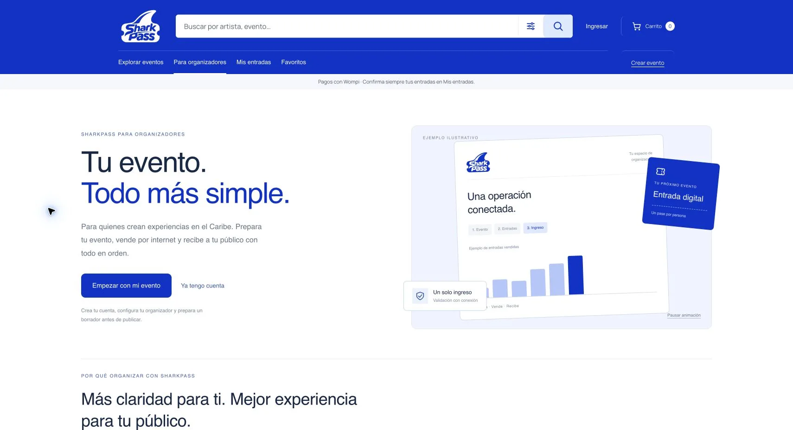

# Presentación para organizadores

La sección pública Para organizadores explica venta, cupos, ingresos y resultados. Una ilustración construida con HTML/CSS muestra una operación de ejemplo, sin pedidos ficticios presentados como reales. La animación se puede pausar y respeta movimiento reducido. No se añadieron dependencias.

El simulador estima exclusivamente ingresos brutos: precio por entrada × cantidad. No altera eventos ni crea ventas. Aclara que costos, impuestos y tarifas deben considerarse antes de estimar utilidad; no promete ganancias ni ventas. Rechaza valores fuera del rango y pesos fraccionarios.

La acción principal lleva al acceso real de la plataforma. Los usuarios autenticados conservan las herramientas de administración; tienen un enlace para consultar esta presentación. No se cambiaron permisos ni se asignan roles por visitar la página.

Validación: 94 pruebas, incluyendo dos de cálculo y límites; comprobación de pausa, cambios de precio/cantidad, transición al formulario de acceso y eliminación del estilo de presentación al salir. Se verifica la adaptación a 390 y 320 px. El build exporta Android/iOS/web; el contenedor sirve la versión final.

Los módulos de presentación y selección de sillas utilizan versiones nuevas en la URL para evitar que una copia anterior de la CDN o del navegador oculte las bandas de disponibilidad.

Publicación comprobada el 8 de noviembre de 2026.

